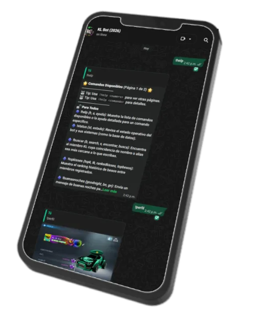
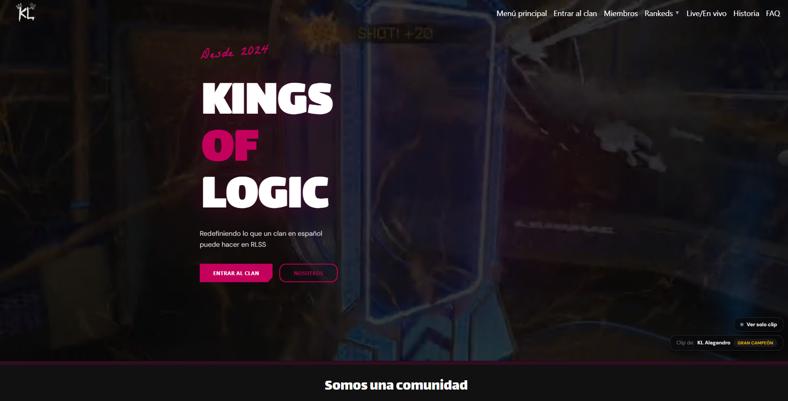
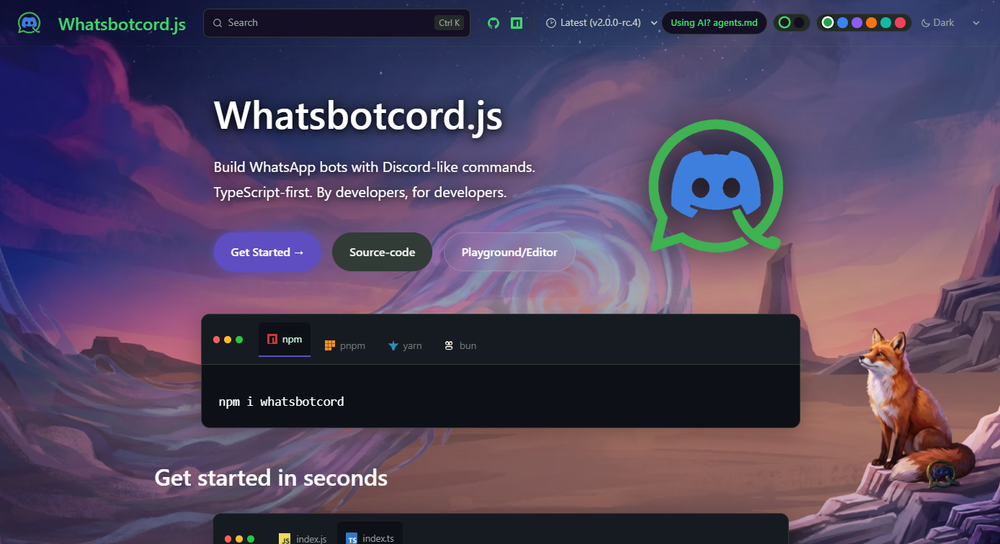
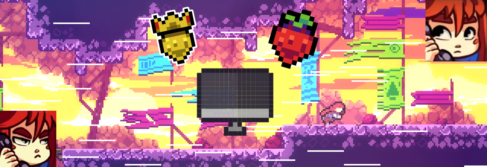

<h1 align="center">KristanLaimon</h1>

<h3 align="center">Hi there! I'm a (fox) developer working toward becoming a software engineer. Coding for fun & work.</h3>

<table align="center" width="100%">
<tr>
<td align="center" valign="middle" width="30%">

<h3 align="center">Frontend</h3>

   
  
  
  
  
  
  
  
  
    

</td>
<td align="center" valign="middle" width="40%">
  
  <h2 align="center">Hi!</h2>
</td>
<td align="center" valign="middle" width="30%">

<h3 align="center">Backend</h3>

   
  
  
  
  
  
  
  
  
    

</td>
</tr>
</table>

<h3 align="center">Miscellanea</h3>

   
  
  
  
  
  
  
    

## My best projects

  

  

  

## More about me

<table width="100%">
<tr><td>

### KL software, tech guy & admin

I'm an admin in **Kings of Logic**, a Rocket League Sideswipe clan, and their software-computer-whatever guy since 2024.

I build and maintain these private projects:

- [KL Website](https://www.kingsoflogic.site): the clan's website.
- **KL WhatsApp Bot**: handles tournament info, members, and other stuff inside the clan chats. Powered by WhatsBotCord.js.
- **KL REST API**: feeds the website with content stored by the bot.

 

</td></tr>
</table>

<table width="100%">
<tr><td align="right">

<h3 align="right">WhatsBotCord & bot automation</h3>

  I build and maintain <a href="https://github.com/KristanLaimon/WhatsBotCord.js"><strong>WhatsBotCord.js</strong></a>, my library for WhatsApp automation. 
  It's what powers the KL bot and my own automation projects.

  

</td></tr>
</table>

<table width="100%">
<tr><td>

### Celeste player & modder

As an experienced (and addicted) Celeste player, I like working on small modding and tooling projects from time to time:

- [TheCelesteTracker](https://github.com/KristanLaimon/TheCelesteTracker-Mod): a companion app to track Celeste stats across vanilla, mods, and lobbies.
- [TheCelesteTracker-EverestMod](https://github.com/TheCelesteHub/TheCelesteHub): tracks stats in real time while playing and feeds TheCelesteTracker.

More projects live in [TheCelesteHub](https://github.com/TheCelesteHub/).

</td></tr>
</table>

🦊 Contributions are always welcome.

  
Stats & tools

---

My profile picture is my OC (original character), designed and made by [@tomateranci0 on Instagram](https://www.instagram.com/tomateranci0?exln=NGRtNXpieHZ3Ymo0) · [Tumblr](https://www.tumblr.com/tomateranci0?source=share).

